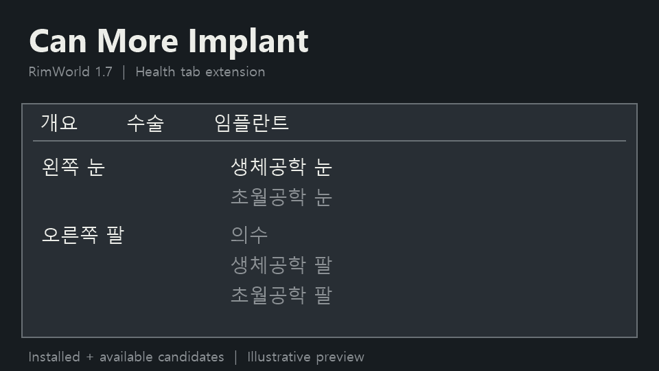

# Can More Implant

Adds an Implants tab to the Health panel.
Compare installed implants, replacement candidates, and their main effects by body part.
Use the Operations tab to schedule surgery.
Requires RimWorld 1.7 and Harmony. English and Korean supported.

건강 창에 임플란트 탭을 추가합니다.
부위별로 장착된 임플란트와 교체 후보, 주요 효과를 비교할 수 있습니다.
수술 예약은 기존 수술 탭을 이용해주세요.
RimWorld 1.7과 Harmony가 필요합니다. 영어·한국어를 지원합니다.

[Download 0.3.2 / 다운로드](Dist/CanMoreImplant-0.3.2.zip)

Development preview. Compatibility testing is ongoing.
개발 중인 버전입니다. 모드 조합별 호환성 검증은 진행 중입니다.

[Usage / 사용 안내](Docs/USAGE.md) · [Compatibility / 호환성](Docs/COMPATIBILITY.md) · [Testing / 검증](Docs/TESTING.md) · [Development / 개발 내역](Docs/DEVELOPMENT.md) · [Workshop / 창작마당 게시](Docs/WORKSHOP.md)
